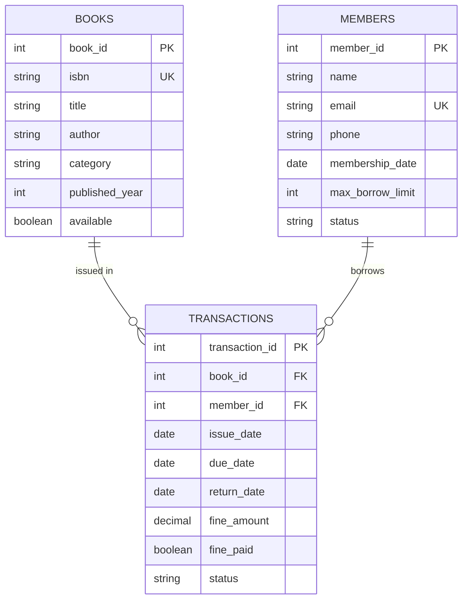

# 📚 LibraryOS — Enterprise Library Management System

A comprehensive, full-featured Library Management System featuring a **Modern Web UI Dashboard** and a **Robust Core Java Backend** built with Object-Oriented Principles, DAO design pattern, and MySQL/In-Memory persistence.

---

## 🌟 Key Features

### 💻 1. Web Application (`LibraryOS`)
- **Executive Dashboard:** Live metrics for total books, active loans, registered members, and outstanding overdue fines.
- **Books Catalog:** Full catalog browsing, live search, multi-category filtering, and dynamic book registration.
- **Circulation Management:** Seamless Book Checkout (Issue) and Check-in (Return) workflows with automated due date tracking.
- **Member Directory:** Member profiles, borrowing limits, active status indicators, and contact details.
- **Overdue & Fine Settlement:** Automatic fine calculation ($/day past due) and one-click fine settlement.
- **Modern Responsive UI:** Glassmorphism aesthetics, dark mode design, toast notifications, and zero external framework dependencies.

### ☕ 2. Java Core Console Application
- **Layered Architecture:** Clear separation of concerns (Models, DAOs, Services, CLI Controller).
- **Design Patterns:** Factory Pattern (`DAOFactory`), Data Access Object (`DAO`), Service Layer, and Encapsulation.
- **Dual Storage Engine:**
  - **Live MySQL Database:** Connected via JDBC (`DBConnection`) with transactional integrity.
  - **In-Memory Fallback:** Automated fallback mode with pre-loaded mock data when MySQL is offline.
- **Automated Fine Calculation:** Custom business logic to calculate fines on overdue returns.
- **One-Click Runner:** Windows batch automation script (`run.bat`) for compilation and execution.

---

## 🛠️ Tech Stack

| Layer | Technologies |
|---|---|
| **Frontend** | HTML5, CSS3 (Modern Flexbox/Grid, Glassmorphism), Vanilla JavaScript (ES6+) |
| **Backend** | Java (JDK 8+), JDBC (Java Database Connectivity) |
| **Database** | MySQL (with InnoDB engine, foreign key constraints, indexes) |
| **Architecture** | DAO Pattern, Factory Pattern, Service-Oriented Architecture (SOA) |
| **Scripts** | Windows Batch Script (`run.bat`), SQL DDL (`schema.sql`) |

---

## 📁 Project Structure

```plaintext
library-management-system/
│
├── index.html                  # Main Web Application entry point
├── css/
│   └── style.css               # Modern glassmorphism stylesheet
├── js/
│   └── app.js                  # Frontend state management & business logic
│
├── Project_Source_Code/        # Core Java Application
│   ├── Book.java               # Book entity model
│   ├── BookDAO.java            # Book Data Access Interface
│   ├── BookDAOImpl.java        # JDBC & In-memory DAO implementation
│   ├── DAOFactory.java         # Factory for database/mock storage abstraction
│   ├── DBConnection.java       # Database connection manager (JDBC)
│   ├── Exceptions.java         # Custom application exceptions
│   ├── LibraryServiceImpl.java # Core business logic & circulation rules
│   ├── Main.java               # Interactive Console Menu
│   ├── Member.java             # Member entity model
│   ├── MemberDAO.java          # Member Data Access Interface
│   ├── MemberDAOImpl.java      # Member DAO implementation
│   ├── Person.java             # Base person class (inheritance demonstration)
│   ├── Transaction.java        # Circulation & loan transaction model
│   ├── TransactionDAO.java     # Transaction Data Access Interface
│   ├── TransactionDAOImpl.java # Transaction DAO implementation
│   ├── TransactionStatus.java  # Enum for loan statuses (ISSUED, RETURNED, OVERDUE)
│   ├── db.properties           # MySQL connection configuration
│   ├── schema.sql              # Database creation and table DDL scripts
│   └── run.bat                 # Automatic compilation and execution script
│
└── README.md                   # Project documentation
```

---

## 🚀 Getting Started

### Option A: Running the Web Application
No installation or local server required!
1. Clone the repository:
   ```bash
   git clone https://github.com/Leelakrishna00/Library-Management-System.git
   ```
2. Open `index.html` directly in any modern web browser (Google Chrome, Microsoft Edge, Mozilla Firefox).

---

### Option B: Running the Java Application

#### Prerequisites
- **Java Development Kit (JDK 8 or higher)** installed and added to `PATH`.
- *(Optional)* **MySQL Server** (if running with live database storage).
- *(Optional)* **MySQL Connector/J JAR** placed in a `lib/` directory if connecting to live MySQL.

#### 1. Setup the Database (Optional)
If using MySQL, create the database schema:
1. Open your MySQL client (e.g., MySQL Workbench or MySQL CLI).
2. Execute the script located at:
   ```sql
   Project_Source_Code/schema.sql
   ```
3. Update your database credentials in `Project_Source_Code/db.properties`:
   ```properties
   db.url=jdbc:mysql://localhost:3306/library_db
   db.user=root
   db.password=your_password
   ```

> 💡 **Note:** If MySQL is not running or credentials are not configured, the application **automatically runs in In-Memory Simulation mode** with sample data so you can test immediately without any database setup!

#### 2. Run the Java Program

**Using the Batch script (Windows):**
Double-click `Project_Source_Code/run.bat` or run:
```cmd
cd Project_Source_Code
run.bat
```

**Using the Command Line manually:**
```bash
cd Project_Source_Code
mkdir bin
javac -encoding UTF-8 -d bin *.java
copy db.properties bin\
java -cp bin library.Main
```

---

## 📊 Database Schema



---

## 👤 Author

- **Vipparla Leela Krishna**
- **GitHub:** [@Leelakrishna00](https://github.com/Leelakrishna00)

---

## 📄 License
This project is open-source and available under the [MIT License](LICENSE).
